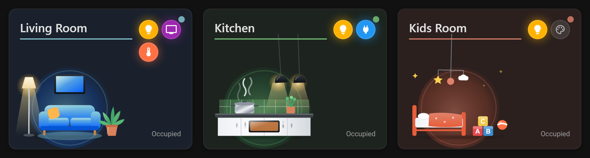
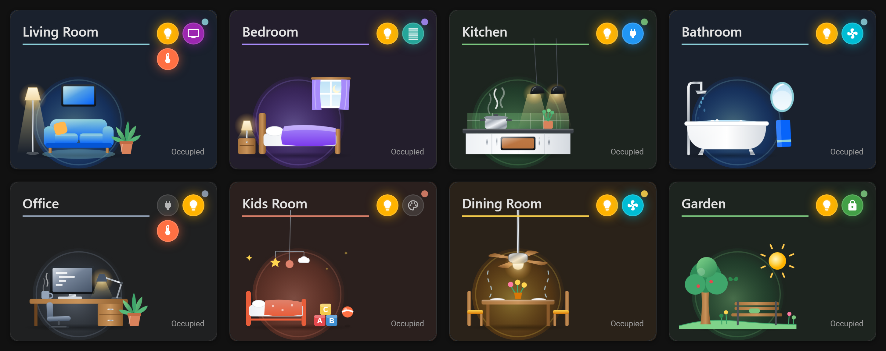
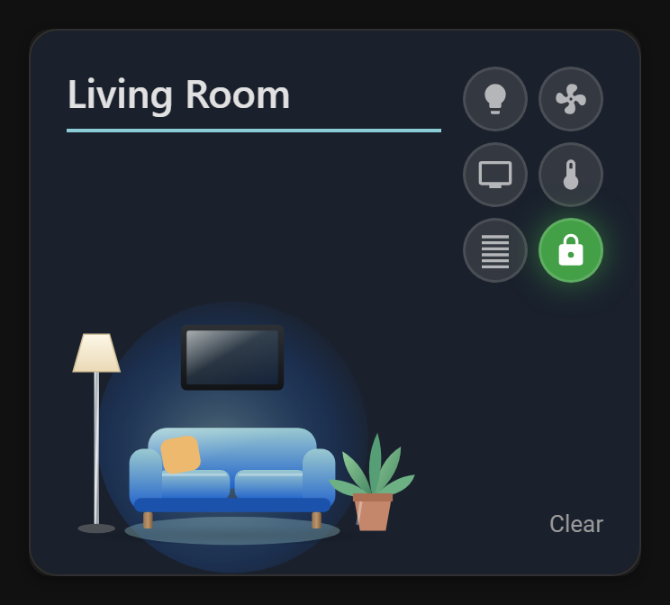
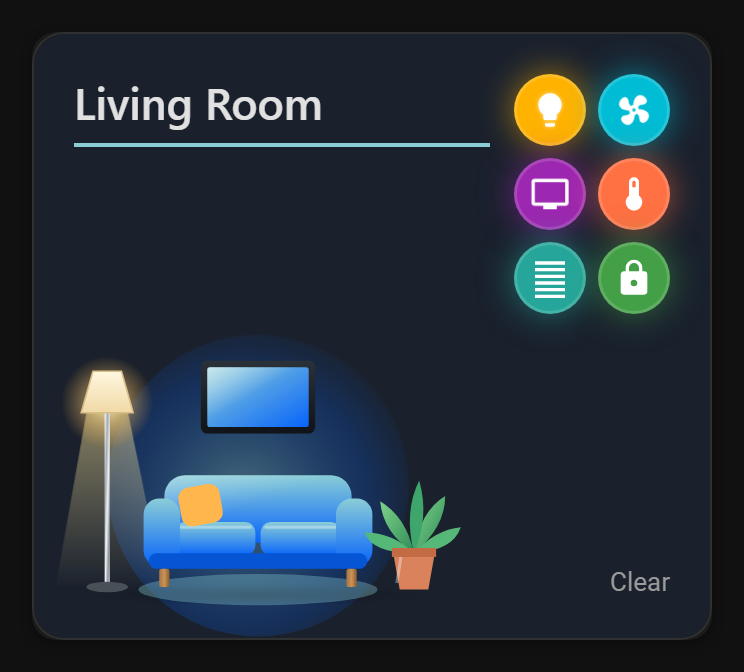
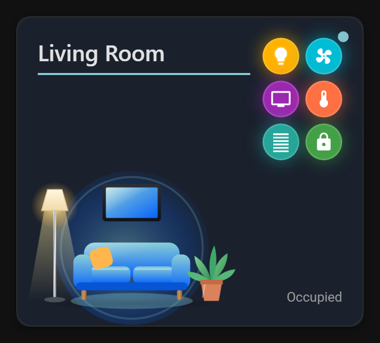
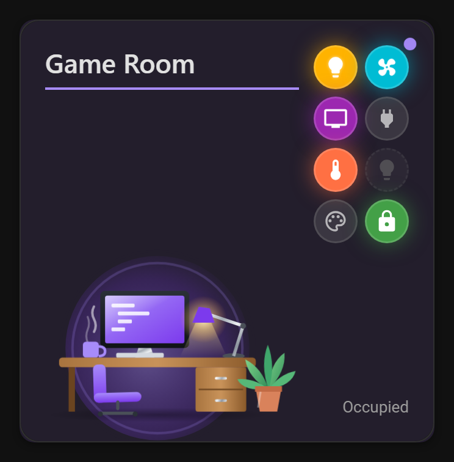
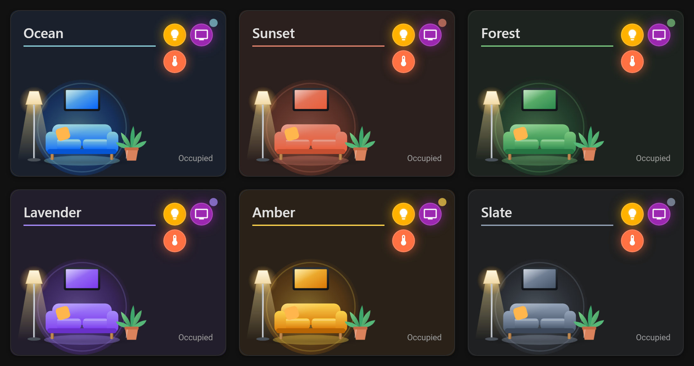
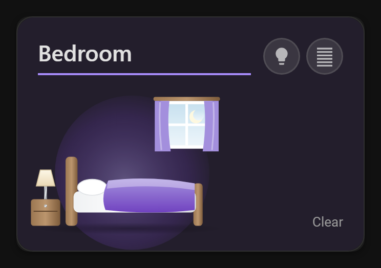
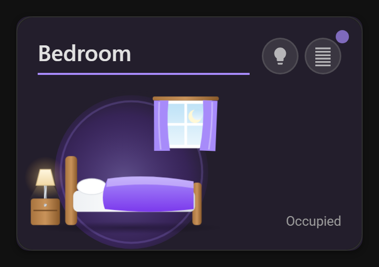

# Area Control Card

> A reusable, GUI-configurable Home Assistant custom Lovelace card for room/area control with HACS distribution.

[](https://github.com/hacs/integration)


---

**Area Control Card** gives any Home Assistant user a beautiful, interactive room control panel — configured entirely through the visual editor (GUI). Pick an area, and the card auto-discovers devices. Pick a color theme, and the entire card adapts. Pick a motion sensor, and the room scene comes alive when someone walks in. **Zero YAML required.**



## Features

- **Zero YAML** — Full GUI visual editor, no YAML needed for basic setup
- **Area Auto-Discovery** — Select an area and the card automatically finds all devices and entities
- **9 Entity Domains** — Lights, fans, switches, media players, climate, covers, locks, scenes & scripts (other domains can be added in YAML)
- **Animated Room Scenes** — 8 illustrated rooms (living room, bedroom, kitchen, bathroom, office, kids room, dining room, garden) that come alive on motion, picked automatically from the area icon or name
- **Colorful Chips** — Each domain has its own color and icon animation (glowing bulbs, spinning fans, pulsing media)
- **6 Color Themes** — Ocean, Sunset, Forest, Lavender, Amber, Slate — the room scenes follow the theme too
- **Presence Sensing** — One or more motion/occupancy sensors per area; animated scene, badge and border glow while any of them detects motion
- **Glassmorphism Design** — Backdrop blur, semi-transparent layers, subtle glow effects
- **Responsive** — Works on mobile, tablet, desktop, and cast displays
- **i18n Ready** — English and Hebrew included, easily extensible
- **Lightweight** — Single JS file, no dependencies on other custom cards

---

## Room Scenes

Eight animated rooms, each tinted by the card's color theme. When the room's motion sensor fires, the scene comes alive: lamps warm up, curtains and plants sway, steam rises, water drips, the mobile swings and the ceiling fan turns.



| All off | Devices on | Motion detected |
|:---:|:---:|:---:|
|  |  |  |

---

## Installation

[](https://my.home-assistant.io/redirect/hacs_repository/?owner=crs2007&repository=area-control-card&category=plugin)

<details>
<summary>Click to show installation instructions</summary>

### Method 1 — HACS (Recommended)

1. Make sure [HACS](https://hacs.xyz/) is installed in your Home Assistant instance.
2. Click the button above **or** go to **HACS > Frontend > "+" > Search "Area Control Card"**.
3. Click **Download**.
4. Reload your browser (**Ctrl + F5** / **Cmd + Shift + R**).
5. Add the card via the visual editor.

### Method 2 — Manual

1. Download `area-control-card.js` from the [latest release](https://github.com/crs2007/area-control-card/releases).
2. Copy the file to your `config/www/` folder.
3. In Home Assistant go to **Settings > Dashboards > Resources** and add:
   - **URL:** `/local/area-control-card.js`
   - **Type:** JavaScript Module
4. Reload your browser.
5. Add the card via the visual editor.

</details>

---

## Configuration (GUI)

The card is fully configurable from the Home Assistant visual editor. No YAML needed.

<details>
<summary>Click to show configuration details</summary>

After adding the card to your dashboard, the visual editor provides five sections:

### Section 1 — Room Setup

| Setting | Description | Default |
|:---|:---|:---|
| Area | Dropdown of all HA areas — filters entities to that area | — |
| Display Name | Custom room name override | Area name |
| Navigation Path | Path to navigate on card tap (e.g., `/dashboard/office`) | — |

### Section 2 — Appearance

| Setting | Description | Default |
|:---|:---|:---|
| Color Theme | 6 preset color swatches to pick from | Ocean |
| Room Scene | Animated room illustration: Auto, None, or a specific room | Auto |
| Card Icon | Icon shown in the bottom-left circle | — |
| Image URL | Image shown in the bottom-left circle | — |

The bottom-left visual uses the first one available: **Card Icon → Image URL → Room Scene (chosen) → Area Picture → Room Scene (auto) → Area Icon → animated gradient**.

With **Auto**, the scene is picked from the area icon (e.g. `mdi:sofa` → living room, `mdi:bed` → bedroom) and then from the area name (English and Hebrew keywords such as *kitchen*, *bath*, *office*, *סלון*, *מטבח*). An area picture still wins over an automatic match, so choose a room scene explicitly to show the scene instead.

### Section 3 — Presence Sensor

| Setting | Description | Default |
|:---|:---|:---|
| Sensors | One or more `binary_sensor.*` entities in the selected area (occupancy/motion/presence device class). The room counts as occupied while any of them is on. | None |

### Section 4 — Entity Controls

| Setting | Description |
|:---|:---|
| Entity List | Auto-populated from area entities, grouped by domain |
| Pin/Unpin | Toggle entities to show as chips on the card (max 8) |
| Reorder | Move pinned entities up/down to set display order |

### Section 5 — Advanced (collapsed by default)

| Setting | Description | Default |
|:---|:---|:---|
| Tap Action | Action on card tap | Navigate |
| Hold Action | Action on card hold | More Info |
| Double-Tap Action | Action on card double-tap | None |

</details>

---

## Supported Entity Domains

<details>
<summary>Click to show supported domains</summary>

Each entity domain gets a chip with tap-to-toggle and state-aware visuals:

| Domain | Icon | Chip Tap Action | Visual State |
|:---|:---|:---|:---|
| `light` | `mdi:lightbulb` | Toggle on/off | Amber, bulb glows |
| `fan` | `mdi:fan` | Toggle on/off | Cyan, icon spins |
| `switch` | `mdi:power-plug` | Toggle on/off | Blue |
| `media_player` | `mdi:television` | Toggle on/off | Purple, icon pulses |
| `climate` | `mdi:thermometer` | Toggle on/off | Orange, icon floats |
| `cover` | `mdi:blinds` | Open/close | Teal when open |
| `lock` | `mdi:lock` | Lock/unlock | Green when locked |
| `scene` | `mdi:palette` | Activate | One-shot |
| `script` | `mdi:script-text` | Execute | One-shot |



**Chip visual states:**
- **Active (ON):** Domain-colored background + white icon + glow animation
- **Inactive (OFF):** Semi-transparent background + bordered chip + muted icon
- **Unavailable:** Greyed out + dashed border + non-interactive

</details>

---

## Color Themes

<details>
<summary>Click to show color presets</summary>

Six built-in color presets are available, each adapting to HA dark and light modes. The room scene follows the theme too:



| Preset | Primary | Accent | Best For |
|:---|:---|:---|:---|
| **Ocean** | `#0764FA` | `#8ACDD7` | Cool, tech-forward rooms |
| **Sunset** | `#E85D3A` | `#DF826C` | Warm, cozy spaces |
| **Forest** | `#2D8A4E` | `#7BC67E` | Natural, calming feel |
| **Lavender** | `#7C3AED` | `#A78BFA` | Elegant, modern style |
| **Amber** | `#D97706` | `#FCD34D` | Energetic, bright rooms |
| **Slate** | `#475569` | `#94A3B8` | Professional, neutral |

</details>

---

## Presence Detection

<details>
<summary>Click to show presence features</summary>

When one or more presence/motion sensors are configured and any of them detects motion:

| Clear | Occupied |
|:---:|:---:|
|  |  |

| Feature | Occupied | Clear |
|:---|:---|:---|
| Status text | "Occupied" | "Clear" |
| Presence badge | Animated pulsing dot | Hidden |
| Room scene | Comes alive: lamps warm up, plants and curtains sway, steam rises, the fan turns, motion ripples | Static and slightly muted |
| Card / area icon | Ripple rings and a playful wiggle | Static |
| Image / gradient | Image breathing / gradient shift | Static |
| Border | Colored glow pulse | No glow |

The room scene also reflects the chips on the card even without motion: lamps glow while a light is on, the TV lights up while a media player plays, and the ceiling fan spins while a fan is on.

If no presence sensor is selected, the card works normally without these features. All animations stop when the system asks for reduced motion.

</details>

---

## YAML Configuration (Advanced)

<details>
<summary>Click to show YAML reference</summary>

While the GUI editor is recommended, you can also configure the card via YAML:

```yaml
type: custom:area-control-card
area: office
name: My Office
color_preset: ocean
room_type: office # auto (default), none, living, bedroom, kitchen, bathroom, office, kids, dining, outdoor
# card_icon: mdi:desk
# image_url: /local/images/office.jpg
presence_entity: binary_sensor.office_motion # or a list of sensors
navigation_path: /dashboard/office
entities:
  - entity: light.office_ceiling
    name: Ceiling Light
    icon: mdi:ceiling-light
  - entity: fan.office_fan
  - entity: switch.office_monitor
  - entity: media_player.office_speaker
    tap_action: # run a script instead of toggling; the chip still shows the TV state
      action: perform-action
      perform_action: script.office_tv_on
  - entity: climate.office_ac
  - entity: binary_sensor.office_door
    tap_action:
      action: more-info
```

### Config Reference

| Key | Type | Required | Default | Description |
|:---|:---|:---|:---|:---|
| `area` | string | No | — | Home Assistant area ID |
| `name` | string | No | Area name | Display name override |
| `color_preset` | string | No | `ocean` | One of: `ocean`, `sunset`, `forest`, `lavender`, `amber`, `slate` |
| `card_icon` | string | No | — | MDI icon for the bottom-left visual (takes priority over everything else) |
| `image_url` | string | No | — | Image for the bottom-left visual (takes priority over the area picture) |
| `room_type` | string | No | `auto` | Room scene: `auto`, `none`, `living`, `bedroom`, `kitchen`, `bathroom`, `office`, `kids`, `dining` or `outdoor` |
| `presence_entity` | string or list | No | — | One `binary_sensor` entity ID, or a list of them, for presence detection. Occupied while any is on. |
| `navigation_path` | string | No | — | Dashboard path to navigate on card tap |
| `entities` | list | No | Auto-discovered | List of entities (max 8). Plain entity ids are accepted. When empty, the card shows the supported entities of the area. |
| `entities[].entity` | string | Yes | — | Entity ID |
| `entities[].name` | string | No | Friendly name | Display name override |
| `entities[].icon` | string | No | Domain default | Custom MDI icon |
| `entities[].tap_action` | object | No | Toggle | Standard HA action run when the chip is tapped (e.g. `perform-action` a script, `more-info`, `none`). The chip still shows its entity's state. YAML only. |
| `tap_action` | object | No | `navigate` | Standard HA action. `navigate` uses `navigation_path` if the action has none. |
| `hold_action` | object | No | `more-info` | Standard HA hold action |
| `double_tap_action` | object | No | `none` | Standard HA double-tap action |

</details>

---

## Translations

<details>
<summary>Click to show i18n details</summary>

The card ships with **English** and **Hebrew** translations and auto-detects the HA language setting.

### Adding a New Language

1. Fork this repository.
2. Copy `src/locales/en.json` to `src/locales/{locale}.json` (e.g., `fr.json`).
3. Translate all values (keep keys unchanged).
4. Submit a Pull Request.

See [src/locales/translations/README.md](src/locales/translations/README.md) for details.

</details>

---

## Troubleshooting

<details>
<summary>Click to show troubleshooting tips</summary>

| Issue | Solution |
|:---|:---|
| Card not showing up | Clear browser cache and reload. Verify the resource is added under **Settings > Dashboards > Resources**. |
| No entities found | Make sure your devices are assigned to an area in **Settings > Areas**. |
| Presence not working | Verify the sensor has `device_class` set to `occupancy`, `motion`, or `presence`. |
| Animations are laggy | The card respects `prefers-reduced-motion`. On older devices, animations are automatically reduced. |

**Minimum Requirements:**
- Home Assistant **2023.4** or newer
- A modern browser (Chrome, Firefox, Safari, Edge)

</details>

---

## Development

<details>
<summary>Click to show developer setup</summary>

```bash
# Clone the repository
git clone https://github.com/crs2007/area-control-card.git
cd area-control-card

# Install dependencies
npm install

# Build the card
npm run build

# Watch for changes during development
npm run watch

# Run linting
npm run lint

# Run tests
npm test
```

The built file is output to `dist/area-control-card.js`. Copy it to your HA `config/www/` folder for testing.

</details>

---

## License

This project is licensed under the [MIT License](LICENSE).

### Credits

The room scene artwork style, shared gradients, ceiling fan and lamp light cones are adapted from [ha-appliance-electromenager-cards](https://github.com/skyrotter/ha-appliance-electromenager-cards) by skyrotter (MIT). See [THIRD_PARTY_NOTICES.md](THIRD_PARTY_NOTICES.md).

---

## Contributing

Contributions are welcome! Run `npm run lint`, `npm test` and `npm run build` before opening a pull request.

If you find a bug or have a feature request, please [open an issue](https://github.com/crs2007/area-control-card/issues).
